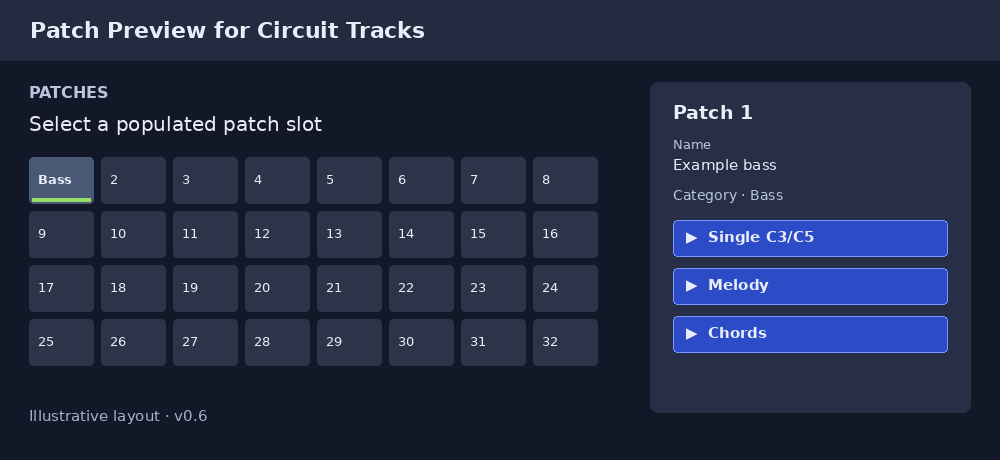

# Circuit Tracks Patch Preview and Random Sound Generator

A free, independent Chrome and Edge extension for the **Novation Circuit Tracks** in the web version of Novation Components:

- **Patch preview** – play the selected patch from a pack on your Circuit Tracks before you load it.
- **Random / Mutate** – generate new synth sounds directly in the Components synth editor. The knobs move, so you can see and fine-tune what was generated.
- **Open .syx / Save .syx** – load a patch file into the editor with one click, and save the current sound from the Circuit Tracks as `.syx` (plus an optional debug JSON).
- **Cross ★** – breed a new sound from two starred sounds in the history.
- **Snapshot A/B** – store a sound and switch between it and your edits.
- **Play / Loop** – play a short phrase of the current sound, or repeat it with a 0–9 second pause (0 = continuous) while you turn knobs.
- **WAV recording** – record the Circuit Tracks output through an audio interface, one sound or a whole batch of `.syx` files, with a level and brightness analysis (`analysis.csv`).

Slovak user guide: [docs/PRIRUCKA.md](docs/PRIRUCKA.md).

## Install

1. Download and extract the repository ZIP. Open the folder that contains `manifest.json`.
2. In Chrome open `chrome://extensions`. In Edge open `edge://extensions`.
3. Enable **Developer mode**, click **Load unpacked**, and select that folder. Remove an earlier copy of this extension first.
4. Open or refresh [Novation Components](https://components.novationmusic.com/) in the same browser. Allow MIDI and SysEx access when asked.

## Patch preview (Packs)

Open **Circuit Tracks → Packs → Patches** and select a populated slot. Three buttons appear below **Category**:

| Button | What it plays |
| --- | --- |
| **Single C3/C5** | MIDI notes 48 and 72 (scientific pitch notation, middle C = C4 = MIDI 60). |
| **Melody** | A two-bar C minor rave arpeggio at 144 BPM. |
| **Chords** | Short rave-style triads. |

The extension reads the active Synth 1 patch, loads the selected sound into temporary RAM, checks it, plays the notes and restores the original patch. Nothing is written to a pack or a preset slot.

## Random sound generator (Synth editor)

Open **Circuit Tracks → Synth** and open or create a patch. A panel appears at the top right.

- **Sound type** – Any, Bass, Lead, Pad, Pluck, Keys, Bell, String, Arp, Movement, FX. Donors are filtered by the category stored in each patch (`data/recipes.csv`, column `categories`).
- **Random** – builds a new sound from sections of real patches (`data/corpus.csv`, 542 audible patches decoded from the Novation packs and the YBC Big City / Delorean Dream packs for the original Circuit, which use the same patch layout): oscillators + mixer + voice from one patch, filter, envelopes, LFOs, effects and the modulation matrix from others. Every unlocked section is replaced.
- **Intensity** – wildness. 0 = clean sections of real patches; 100 = random variation, extreme chorus/phaser and distortion values and extra modulation-matrix routings.
- **Mutate** – small changes to the current sound; its character stays.
- **Group locks** – checked groups are not changed.
- **Undo** and a **history** of the last 20 sounds (starred ones are kept). Entries show their origin, e.g. the name of an opened `.syx` or both parents of a cross.
- **Cross** – choose two starred sounds as parents A and B: knobs land between them, switches, pitch steps and the matrix come from one parent; intensity adds randomness.
- **Snapshot / A/B** – Snapshot stores the current sound, A/B swaps the editor between it and the current sound.
- The panel title shows the version read from the loaded `manifest.json`, so you can see whether a reload picked up a new version.
- A few safety rules (minimum mixer level, no endless release, oscillator semitones within ±24, no matrix routing that silences a source). Each rule changes at most a handful of the real patches in the corpus; loudness itself is handled by the level check.

Components sends every change to the Circuit Tracks synth track that is selected in Components. Use MIDI channel 1 for Synth 1 and 2 for Synth 2. **Keyboard Octave** applies to the Circuit Tracks pads, not to incoming MIDI notes, so the extension shifts its phrases by that value.

### Open and save `.syx`

- **Open .syx** loads one or more patch files. The first goes into the editor knobs (everything except macros and the patch name); all of them are added to the history, where Mutate and Cross work on them.
- **Set CT project delay/reverb on open** (on by default) – patches made by [mininova-to-circuit-tracks](https://github.com/imarkone/mininova-to-circuit-tracks) store the original delay and reverb settings in the reserved bytes 18–31. On open, the panel sends them to the Circuit Tracks project FX via MIDI channel 16 (NRPN) and sets the reverb/delay send of the selected synth. Factory patches have no such data, so nothing is sent.
- **Save .syx** reads the current sound from the Circuit Tracks (SysEx dump of Synth 1 or 2) and downloads it as `Rnd <type> <intensity> #<number>.syx`. Upload it in Components via **Packs** as usual.
- **JSON (debug)** also saves the generator settings, seed, donor patches and all values.

### WAV recording

The Circuit Tracks sends no audio over USB. Connect its line outputs to an audio interface input.

1. Click **Load inputs**, allow microphone access and choose the interface input.
2. **● WAV** records the current sound (phrase + 1.5 s tail).
3. **● Batch .syx → WAV** – choose several `.syx` files. Each is sent to the Circuit Tracks, played and recorded. You get one ZIP with a WAV per file and `analysis.csv` (peak, RMS, clipped samples, silence, L/R correlation, spectral centroid). The original patch is restored at the end.

Recording uses an AudioWorklet. Browser echo cancellation, noise suppression and auto gain are switched off so levels stay comparable. Keep the interface gain fixed for all recordings. Between batch files the extension sends All Notes Off and waits until the input is quiet, so a long release does not leak into the next recording.

**Level check and levelling after Random** (needs a selected input): the phrase played after Random is recorded and measured (loudest 50 ms). A silent sound is replaced by a new Random or Cross (up to 3 times). A sound outside the target range (−21 ±4 dBFS) is brought to the target with **Post FX Level** (the last gain stage, in dB, after drive, distortion and EQ), and with the mixer only for what Post FX cannot cover; it is measured again after each correction (up to 2). The target comes from recorded factory patches: they peaked between −30 and −12 dBFS at the author's interface gain, typically −21. Change `data/levels.csv` if your gain differs.

## Files

| File | Purpose |
| --- | --- |
| `preview.js` | Patch preview on the Packs page. |
| `random.js` | Random / Mutate panel, .syx open/save, playback, WAV recording. |
| `loader.js` | Passes the CSV data files to `random.js`. |
| `data/lang.csv` | All panel texts (Slovak and English). |
| `data/recipes.csv` | Per-type wildness and default phrase. |
| `data/phrases.csv` | Note phrases used for playback. |
| `data/corpus.csv` | Decoded factory/community patches used as donors. |
| `data/levels.csv` | Level check: target, tolerance, silence and peak limits, retries, tail. |

## Troubleshooting

- **No panel** – refresh Components and open the Synth editor.
- **No sound** – check the Circuit Tracks audio output, the MIDI channel in the panel and MIDI/SysEx permission. Close other applications using the MIDI port.
- **Restoration could not be verified** (preview) – select your original preset on the hardware again.

The MIDI and SysEx commands are described in the [Circuit Tracks Programmer's Reference Guide V3](https://fael-downloads-prod.focusrite.com/customer/prod/downloads/circuit_tracks_programmer_s_reference_guide_v3.pdf). This community project is independent of Novation and Focusrite. It runs only on `components.novationmusic.com`, has no accounts, analytics or server, and all MIDI and audio stay on your computer.
